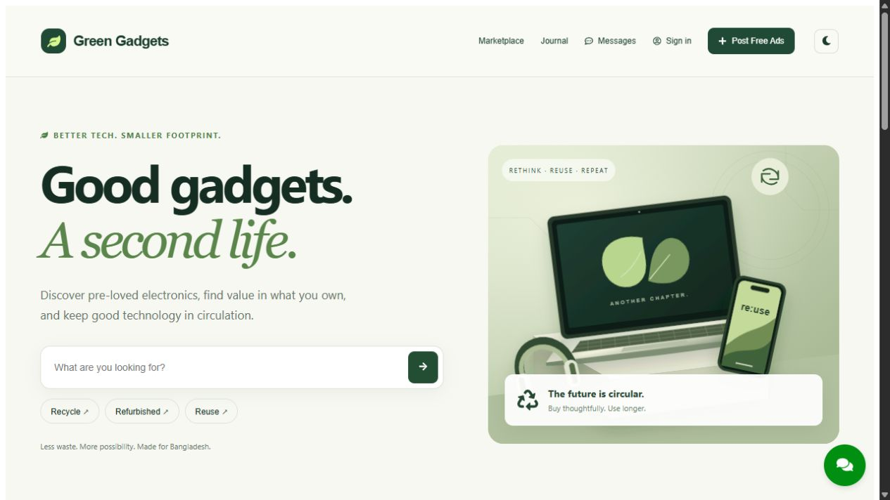

<div align="center">

# Green Gadgets

### Good gadgets. A second life.

An electronics marketplace built around reuse, refurbishment and responsible recycling.

[Live demo](https://green-gadgets.onrender.com) · [Report a problem](https://github.com/tahmidkhanshuvo/Green-Gadgets/issues)

   

</div>



Originally developed for **CSE2200** by **Tahmid Khan, Tahmid Amir, and Saobia Islam Tinni**. Green Gadgets connects people who want technology to last longer. The application provides listings and direct buyer–seller conversations; arrangements between users happen outside the platform.

## What you can do

- Browse real listings, search descriptions/titles, filter by listing type, device category and location, and sort by price.
- Share a filtered search URL and navigate paginated results.
- Create an account, upload photos, and publish a listing with authenticated seller identity.
- Manage your own listings and mark them sold or make them available again.
- Save listings to your account and revisit them in Saved finds.
- Open a seller conversation, exchange text/images, and view your private conversation list.
- Read and publish journal articles, edit your profile, change your password, and use light/dark themes.
- Get marketplace guidance from built-in help, with no external model required.

The account tabs use actual API data. Conversation membership is enforced over HTTP and Socket.IO, sender identity comes from the token, and message drafts remain available if delivery is not confirmed. Rich journal content is sanitized before storage and when older articles are returned.

## Start locally

Use **Node.js 22+**, MongoDB, and a Cloudinary account for image uploads.

```sh
cd backend
npm ci
cp .env.example .env
# Fill the database, signing secret and Cloudinary values.
npm run dev
```

In a second terminal:

```sh
cd frontend
npm ci
cp .env.example .env
npm run dev
```

Open `http://localhost:5173`; the backend listens on port 4000. Keep the frontend origin in `FRONTEND_URL`. API and Socket.IO origins must point to the same backend service unless explicitly configured otherwise.

## Configuration

| Location | Variable                                                               | Purpose                                                      |
| -------- | ---------------------------------------------------------------------- | ------------------------------------------------------------ |
| Backend  | `MONGO_URI`                                                            | MongoDB connection including the intended database           |
| Backend  | `JWT_SECRET`                                                           | Strong server-only token-signing secret                      |
| Backend  | `PORT`                                                                 | API listener, default 4000                                   |
| Backend  | `FRONTEND_URL`                                                         | Allowed frontend origins, comma-separated                    |
| Backend  | `CLOUDINARY_CLOUD_NAME`, `CLOUDINARY_API_KEY`, `CLOUDINARY_API_SECRET` | Durable uploaded images                                      |
| Frontend | `VITE_API_URL`                                                         | Backend origin, without `/api`                               |
| Frontend | `VITE_SOCKET_URL`                                                      | Optional direct Socket.IO origin; defaults to the API origin |

Vite variables are public. Never place signing secrets or private provider keys in them. Uploads require sign-in and are limited to eight images per listing, five per article, one per chat upload, and 8 MB per file. Keep `.env` files outside Git. Dependency folders are no longer tracked; install them from the lockfiles.

## Project map

| Directory                         | Purpose                                                            |
| --------------------------------- | ------------------------------------------------------------------ |
| `backend/controllers`, `routes`   | Authentication, account data, listings, articles and conversations |
| `backend/services/chatService.js` | Shared conversation access and message validation                  |
| `backend/middleware`              | JWT guards, upload handling, validation and rate limits            |
| `backend/models`                  | MongoDB users, ads, blogs and chats                                |
| `backend/test`                    | HTTP, persistence and Socket.IO regression tests                   |
| `frontend/src/components`         | Marketplace, account, listing, article, chat and help interfaces   |
| `frontend/src/context`, `api.js`  | Shared authentication state and scoped API credentials             |

Secondary pages are loaded on demand so article editors and account tools are not part of the initial homepage download. The visual system uses a circular-tech illustration, responsive navigation, matching marketplace/account screens, and working footer links.

## API landmarks

| Endpoint                                                | Purpose                                          |
| ------------------------------------------------------- | ------------------------------------------------ |
| `GET /healthz`                                          | Database-aware readiness check                   |
| `POST /api/auth/register`, `POST /api/auth/login`       | Account access                                   |
| `GET /api/ad`, `GET /api/ad/:id`                        | Available listings and details                   |
| `POST /api/ad`, `GET /api/ad/mine`                      | Authenticated publishing and owned listings      |
| `PATCH /api/ad/:id/status`                              | Owner-only active/sold state                     |
| `GET /api/account/favorites`                            | Saved listings                                   |
| `POST` or `DELETE /api/account/favorites/:id`           | Save/remove a listing                            |
| `GET /api/chats/user/:userId`, `GET /api/chats/:chatId` | The signed-in user's conversations               |
| `POST /api/chats`, `POST /api/chats/message`            | Conversation creation and authenticated messages |
| `POST /api/upload/ad`, `/blog`, `/chat`                 | Authorized Cloudinary uploads                    |
| `GET /api/blog`, `GET /api/blog/:id`, `POST /api/blog`  | Public journal and authenticated publishing      |
| `POST /api/assistant`                                   | Built-in marketplace help                        |

Socket clients authenticate with `auth: { token }`, join an authorized room through `joinChat`, and send messages through `sendMessage`. Successful writes acknowledge `{ ok: true }`; failures provide a controlled error. Never trust a client-supplied sender ID.

## Verify changes

```sh
cd backend
npm test
cd ../frontend
npm run build
```

Tests cover authentication boundaries, password-hash omission, upload access, listing identity, owned/sold listings, persistent/idempotent favorites, password-change verification, HTML sanitization, cross-user conversation isolation and socket acknowledgments. Integration tests use a disposable in-memory MongoDB instance by default. The first run downloads its binary. An explicitly supplied `TEST_MONGO_BASE_URI` instead creates a unique `green_gadgets_test_*` database and drops only its own test collections afterward.

## Deploy

The existing Render Node service uses root `backend`, build `npm ci`, start `npm start`, and `/healthz`. Add production secrets and all intended frontend origins there. The frontend deploys as a static site with root `frontend`, build `npm run build`, output `dist`; set `VITE_API_URL` and, if needed, `VITE_SOCKET_URL`. The Vercel configuration preserves direct client-side URLs on refresh. Socket.IO must connect directly to the Render API, where long-lived connections are supported.

Check the catalogue, sign-in, one disposable listing, saved-listing persistence and a two-account conversation after a release. Retain the previous successful deployment for rollback. Do not reset an existing MongoDB database to deploy a UI update. Free Render services sleep after inactivity, so the first request may be slow.
